<div align="center">

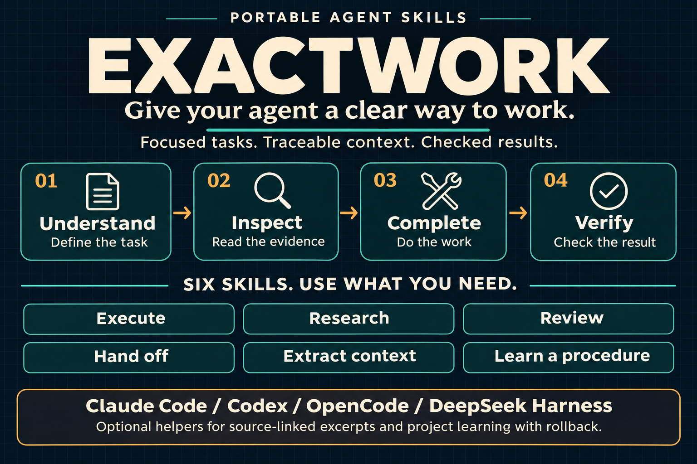

# Exactwork

Agent Skills for **Claude Code · Codex · OpenCode · DeepSeek Harness**

**Give your agent a clear way to work.**

<a href="https://www.npmjs.com/package/@theihtisham/exactwork-skills"></a>
<a href="https://www.npmjs.com/package/@theihtisham/exactwork-skills"></a>
<a href="https://github.com/theihtishaam"></a>

[MIT license](LICENSE) · Python 3.10+ for optional tools · Six independent skills · Reproducible evaluations

[Start here](#start-here) · [Skills](#choose-a-skill) · [Self-learning](#learn-a-project-procedure) · [Results](#measured-improvements) · [Compatibility](#use-it-with-your-agent) · [Research](docs/research.md)

</div>

An agent can produce a convincing answer and still miss a requirement, lose a correction, or call unfinished work done. Exactwork gives it a short, reusable procedure for keeping the task, evidence, and completion checks in view.

Choose from six skills for **execution, research, review, handoffs, context extraction, and project learning**. Each starts with a `SKILL.md`; your agent keeps its existing model, tools, and access. Optional Python helpers handle source-linked excerpts and checked local procedure updates.

## Measured improvements

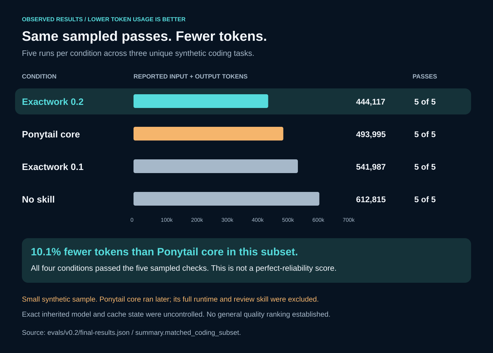

**Why consider Exactwork?** On this small coding subset, compact Exactwork completed the same five sampled checks with **10.1% fewer reported tokens than Ponytail core**. The chart orders conditions by observed token usage, lowest first. Passing five sampled checks does not mean an agent is perfectly reliable.

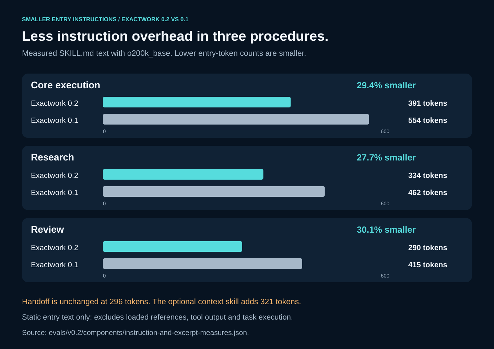

The core entry instructions are **29.4% smaller** in the recorded tokenizer. This measures instruction overhead separately from task-token usage. Hallucination rate, relevance, and broad quality improvements need separate evaluations; they are not established by these charts. [Full task results](#what-the-tests-show) · [Component measurements](docs/component-evidence.md).

## What it helps you do

| When you need… | Exactwork asks the agent to… |
|---|---|
| A task finished to your requirements | Keep the deliverables and constraints visible, complete the affected work, and check the result. |
| A conclusion you can inspect | Read relevant sources, retain references, and identify missing evidence. |
| Continuity across sessions | Carry forward corrections, verified progress, and unfinished work. |
| A useful lesson from a failure | Evaluate one scoped procedure change before keeping it, with rollback available. |

**Start with one skill.** Add companions when the task calls for them. A simple edit should stay simple.

> **Evidence at a glance:** the compact core used **13.8% fewer aggregate tokens** than no skill in a small held-out study. Savings occurred in **3 of 6 paired trials**, across two unique synthetic tasks. These are measured results for that study, not a promise for every project. [See the results and limitations](#what-the-tests-show).

## Start here

With Node.js **20+**, one command installs all six skills for detected supported tools:

```sh
npx --yes @theihtisham/exactwork-skills install --detected
```

The npm package includes the skill files and installer; no GitHub clone is needed. Installation is at user scope by default. Detection checks known tool directories and executable names, not configuration contents. Reload your agent afterward and check its skill list.

```sh
# Preview destinations without writing.
npx @theihtisham/exactwork-skills install --detected --dry-run

# Select a client and an existing project.
npx @theihtisham/exactwork-skills install --agent codex --project ./my-project

# Verify installed files.
npx @theihtisham/exactwork-skills verify --detected
```

The installer preserves conflicting files. Python **3.10+** is needed only for the optional Python helpers. [npm installation, supported targets, and limitations](docs/npm-installation.md).

You can also use the third-party Skills CLI with Node.js 22.20+: `npx skills add theihtishaam/exactwork-skills`. The Python route below supports previewing project installation without npm.

### Install with the bundled Python tool


Clone the repository, then preview installation into an **existing project**:

```sh
git clone https://github.com/theihtishaam/exactwork-skills.git
cd exactwork-skills

python tools/install.py --project "/path/to/project" --client codex
python tools/install.py --project "/path/to/project" --client codex --apply
```

The core is selected by default. The first installer command previews; `--apply` installs. Windows paths such as `"C:/Projects/my-app"` work; use `python3` if needed.

For another client or a companion skill:

```sh
# Install the core for Claude Code.
python tools/install.py --project "/path/to/project" --client claude --apply

# Install just the learning companion for OpenCode.
python tools/install.py --project "/path/to/project" --client opencode --skill exactwork-learn --apply

# Install all six skills for DeepSeek Harness.
python tools/install.py --project "/path/to/project" --client harness --all --apply
```

`--all` means six skills for **one client**. The installer preserves conflicting files and application settings. Manual copying is supported; Python **3.10+** is needed for the installer and optional helpers. [Installation behavior](docs/install-behavior.md).

## Use it with your agent

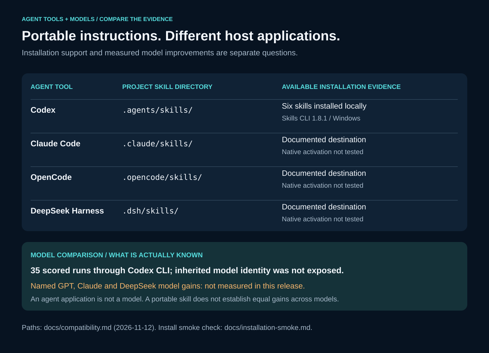

The new direct-install route was checked in an isolated Windows project: all six skill folders were copied for Codex. This verifies installation, not native activation or model performance. [Installation receipt](docs/installation-smoke.md).

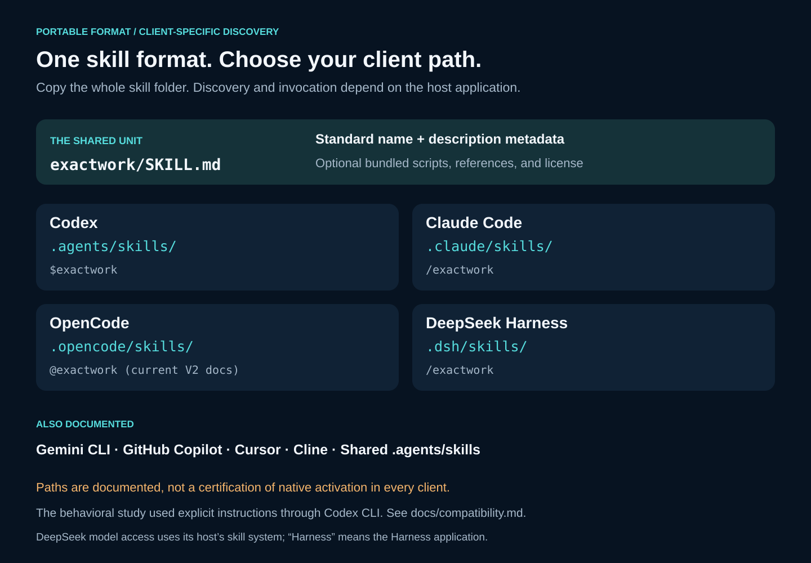

Start a fresh session in the target project and invoke a skill explicitly:

| Client | Project skill directory | Example invocation |
|---|---|---|
| **Codex** | `.agents/skills/` | `$exactwork Fix and test this export bug.` |
| **Claude Code** | `.claude/skills/` | `/exactwork Fix and test this export bug.` |
| **OpenCode** | `.opencode/skills/` | `@exactwork Fix and test this export bug.` |
| **DeepSeek Harness** | `.dsh/skills/` | `/exactwork Fix and test this export bug.` |

The installer also has `gemini`, `copilot`, `cursor`, `cline`, and `shared` targets. Paths were checked against documentation on **2026-11-12**. Your client version and settings determine discovery; a DeepSeek model follows the application running it.

The study used explicit instruction injection through Codex CLI; **native activation was not tested in every client**. Other text-capable agents can receive the chosen `SKILL.md` and its references manually. [Compatibility details and sources](docs/compatibility.md).

## Choose a skill

Choose by the work in front of you. You can install several skills without asking the agent to load every procedure for every task.


| Skill | Example task |
|---|---|
| [**exactwork**](skills/exactwork/SKILL.md) | Fix an export bug, preserve the interface, and verify the result. |
| [**exactwork-research**](skills/exactwork-research/SKILL.md) | Check the original evidence before recommending a change. |
| [**exactwork-review**](skills/exactwork-review/SKILL.md) | Review a queue implementation and report reproducible defects without editing it. |
| [**exactwork-handoff**](skills/exactwork-handoff/SKILL.md) | Prepare another session with current corrections, verified work, and blockers. |
| [**exactwork-context**](skills/exactwork-context/SKILL.md) | Extract relevant log lines with source references and explicit omissions. |
| [**exactwork-learn**](skills/exactwork-learn/SKILL.md) | Test a project procedure change, apply it if eligible, and retain rollback. |

<details>
<summary><strong>Compare instruction sizes</strong></summary>

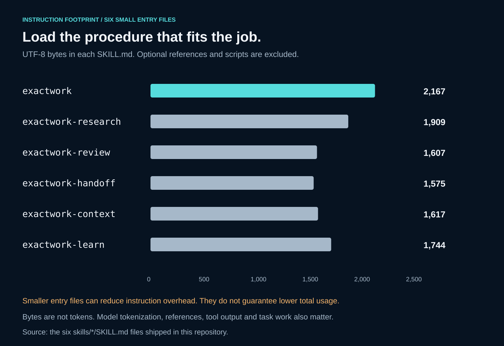

</details>

A label correction usually needs only a direct edit. Load extra procedures when they help; keep domain-specific skills for their expertise.

## What happens during a task

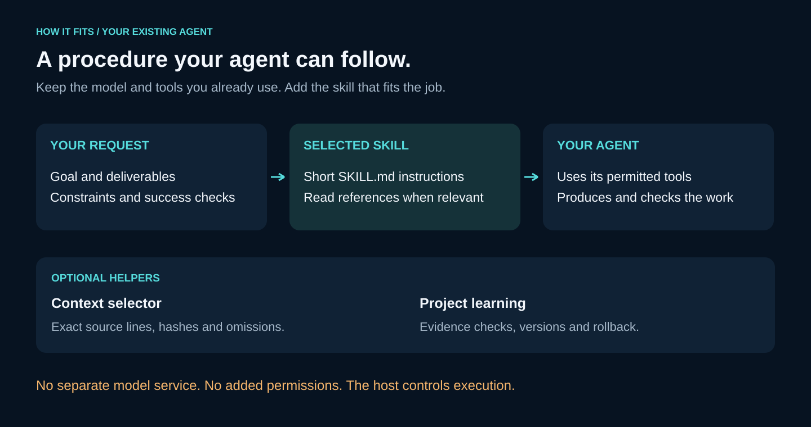

A skill is a procedure the agent reads. It does not provide a new model, grant permissions, or run a separate service. The host decides how skills are discovered and when their instructions are loaded.

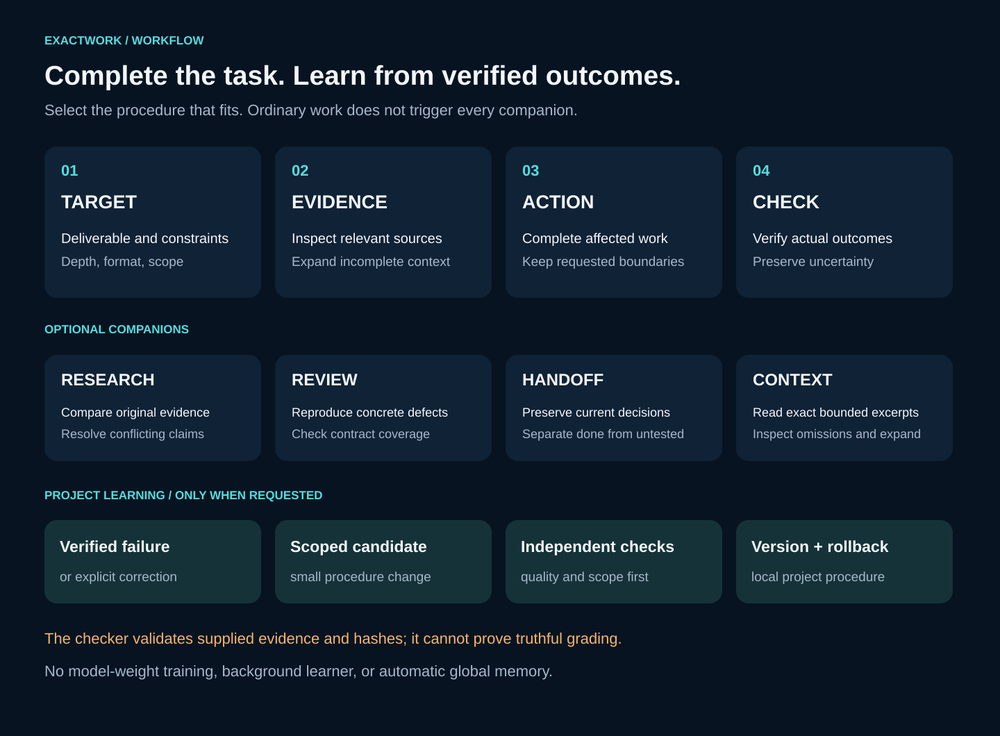

The core keeps the requested deliverables, depth, and format in view. It asks the agent to read relevant evidence, expand incomplete context, finish affected contracts, and distinguish **prepared**, **executed**, and **verified** work.

These are instructions, not runtime guarantees. Correct work may take more tokens; a short response still has to satisfy the request. [Design and tradeoffs](docs/design.md).

### Try it on a real task

Give the agent a concrete result and the constraints that matter:

> Use exactwork to fix the empty-input export failure. Preserve the current output format. Reproduce the failure, make the necessary change, and check empty and normal inputs. Tell me what you verified and anything still unresolved.

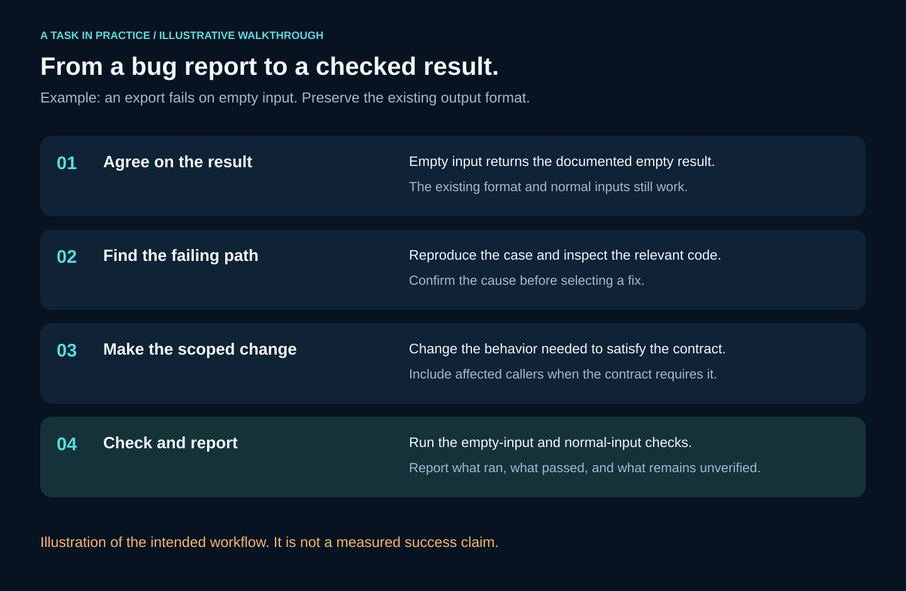

The example shows the intended working pattern. It is not an extra benchmark result; actual checks depend on your project and its requirements.

## Read a large log

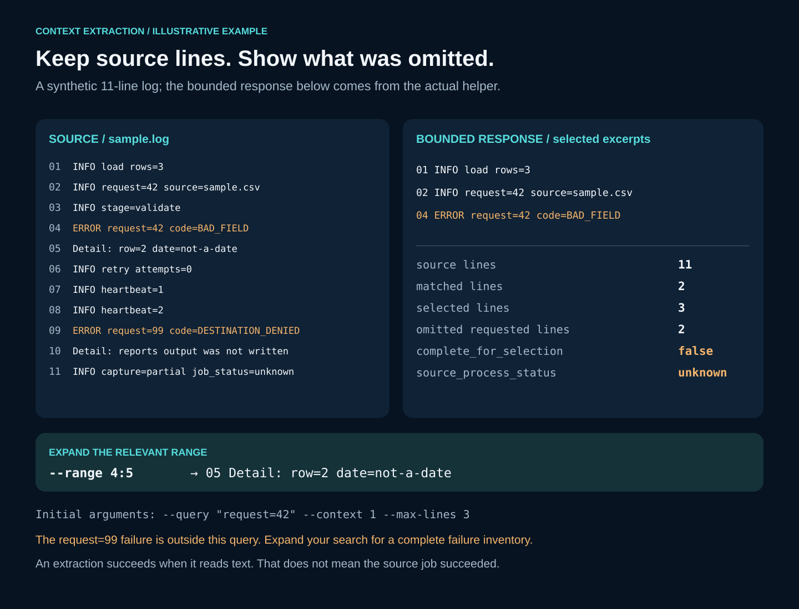

For context engineering on a large log, the optional selector returns bounded JSON with exact lines, source hashes, selected ranges, and omission counters:

```sh
python skills/exactwork-context/scripts/context_slice.py ./build.log --query "request-42" --context 3
```

Expand incomplete excerpts. Zero matches do not rule out defects, and successful extraction does not establish process success. Ordinary search is often enough. [Selector instructions](skills/exactwork-context/SKILL.md) · [Component measurements](docs/component-evidence.md).

## Learn a project procedure


Self-learning here means **improving a project procedure**. The agent proposes and tests a small rule; the helper checks the submitted records and file hashes.

1. Start from a verified failure or your explicit correction, with a clear scope.
2. Freeze the baseline, evaluation setup, rubric, and tasks before drafting the candidate. Keep independent holdouts separate.
3. Compare repair, transfer, regression, and held-out outcomes. Preserve failures and unknown measurements.
4. Promote only when all supplied candidate correctness and scope checks pass, plus a quality gain or comparable actual-token reduction is recorded.
5. Write only the selected project's **`.exactwork/procedure.md`**, retaining an exact backup and checked rollback.

> Use exactwork-learn to learn from this verified project failure. Propose one relevant procedure change, test it against independent cases, and apply it locally only if the evidence passes. Keep rollback available.

Future sessions must load the procedure for its stated scope. There is no background learner, automatic global memory, or model-weight update. The checker validates consistency; it cannot prove truthful grading, authentic telemetry, or genuinely hidden holdouts. **Longitudinal learning benefits have not been measured.** [Learning guide and commands](docs/learning.md).

## What the tests show

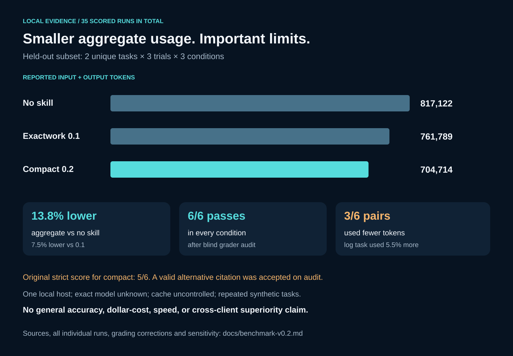

The study includes **35 scored agent runs**: 12 development, 18 held-out, and five supplementary Ponytail comparisons. The held-out subset used **two unique synthetic tasks, repeated three times per condition**:

| Condition | Public-task passes after audit | Aggregate reported input + output tokens |
|---|---:|---:|
| No skill | 6/6 | 817,122 |
| Exactwork 0.1 | 6/6 | 761,789 |
| Compact Exactwork 0.2 | 6/6 | 704,714 |

The compact version used **13.8% fewer aggregate tokens than no skill** and **7.5% fewer than 0.1**. It used more tokens on the log-task aggregate and saved tokens in only 3/6 paired trials. The original strict grader scored the compact condition 5/6; a blind audit accepted a valid alternative citation. Original scores, the correction, and a stricter sensitivity analysis remain available.

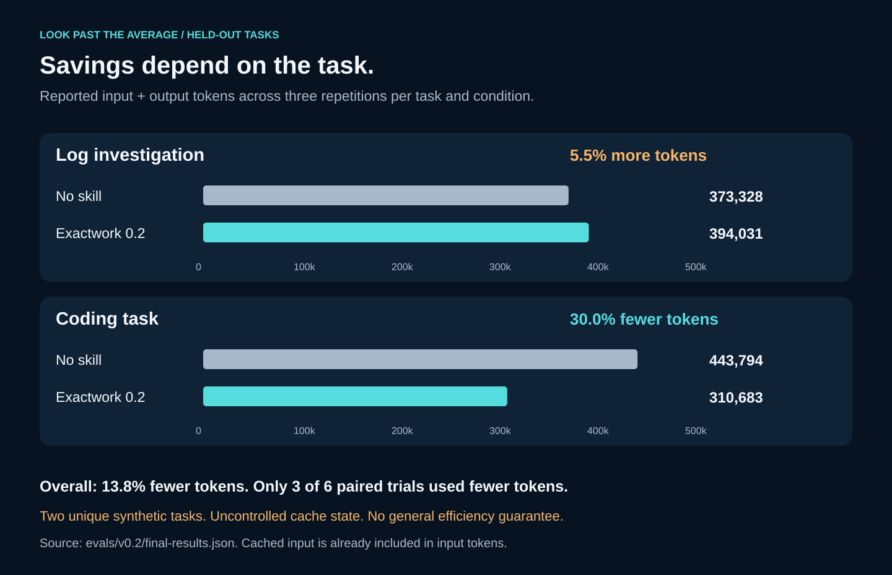


**Intelligence was not directly measured.** The quality chart shows task correctness, a limited measure of completed work. Equal held-out pass counts do not establish smarter reasoning or general accuracy gains. There is no measured long-term learning improvement yet.

The exact inherited model was not exposed, cache state was uncontrolled, and concurrent wall times do not establish agent speed or dollar savings. **111 software checks passed; four were skipped** for unavailable symbolic-link privileges. These checks are separate from model-performance results. [Full benchmark](docs/benchmark-v0.2.md) · [Verification](docs/verification.md) · [Result table](evals/v0.2/final-results.csv).

## Compare with other skill projects

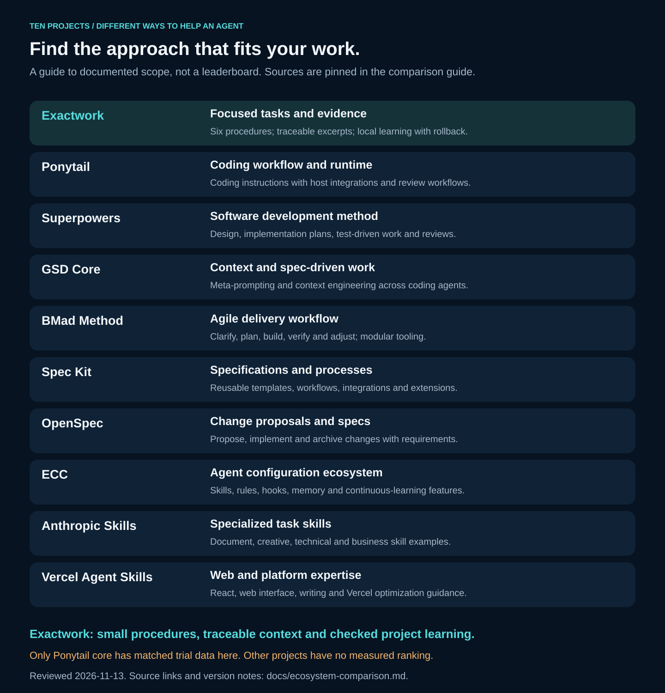

Exactwork is a useful fit when you want **short task procedures, traceable excerpts, and checked local learning with rollback**. Broader development frameworks and specialist libraries solve different problems and can complement that approach. The [ten-project comparison guide](docs/ecosystem-comparison.md) links to pinned sources, explains each project's focus, and separates inspected features from measured results.

Only Ponytail core has matched performance measurements here. The other projects are compared through documentation. General intelligence and named-model quality improvements have not been measured. Unknown results are left unknown.

## How it compares with Ponytail


[Ponytail](https://github.com/DietrichGebert/ponytail), other skill collections, official documentation, and studies with mixed findings informed the design. Exactwork adds independently selectable evidence, handoff, context, and local learning procedures.

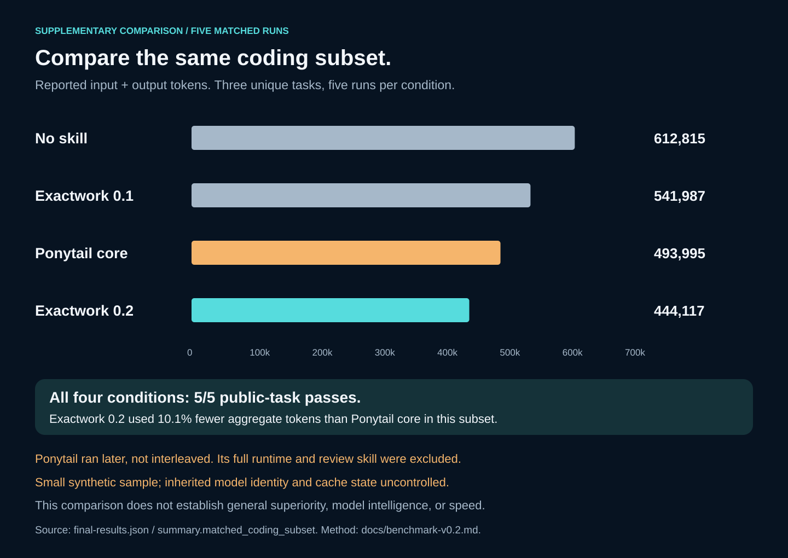

The comparison used pinned Ponytail **core instructions only**, excluding its runtime and review skill. Its runs came after the main study. Both passed the five-run coding subset; that does **not** establish general superiority. [Comparison](docs/comparison.md) · [Research](docs/research.md) · [Upgrade research](docs/upgrade-research.md).

## Common questions

<details>
<summary><strong>Does this replace my agent or existing domain skills?</strong></summary>

No. Exactwork supplies working procedures. Your agent still supplies the model, tools, and execution environment. Keep specialized skills for framework, design, research, or other domain knowledge.

</details>

<details>
<summary><strong>Does self-learning happen automatically?</strong></summary>

No. Invoke the learning skill for a scoped project problem. A candidate procedure needs evaluation before promotion, and future sessions need to load the saved procedure. There is no model training or background learner. [Read the learning guide](docs/learning.md).

</details>

<details>
<summary><strong>Will this always reduce tokens or improve accuracy?</strong></summary>

No. More careful investigation can require more tokens. The published study includes mixed outcomes, original grades, corrections, and a limited comparison. Use your own representative tasks to decide whether a procedure helps.

</details>

## Run the checks

Run the package checks and offline evidence auditor without making model calls:

```sh
python -B -m unittest discover -s tests -v
python -B -m unittest discover -s skills/exactwork-context/tests -v
python -B evals/v0.2/learn-review/test_independent_review.py
python -B evals/v0.2/audit_results.py
python -B tools/validate.py
```

The [full verification commands](docs/verification.md) also cover the exporter and auditor mutation checks. The [GitHub Actions workflow](https://github.com/theihtishaam/exactwork-skills/actions/workflows/check.yml) runs the checks on Windows and Linux with Python 3.10 and 3.12. Open the latest run to see its current status.

Browse the [skills](skills), [tools](tools), [docs](docs), [evaluation records](evals/v0.2), and [editable graphics](assets). Original grades, corrections, observable traces, and audit tools are included.

Contributions should include a reproducible failure or measured improvement, with unsuccessful outcomes preserved. [Contributing guide](CONTRIBUTING.md). Code and skills use [MIT](LICENSE); [visual provenance](assets/PROVENANCE.md) identifies the AI-generated cover and authored diagrams.
