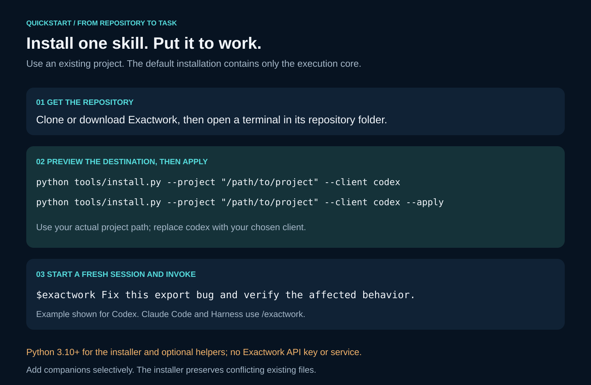
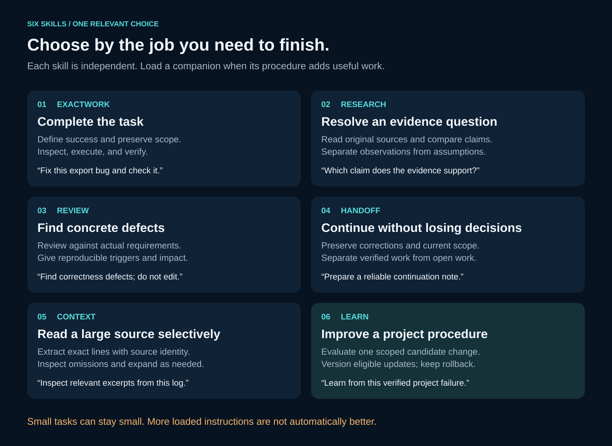
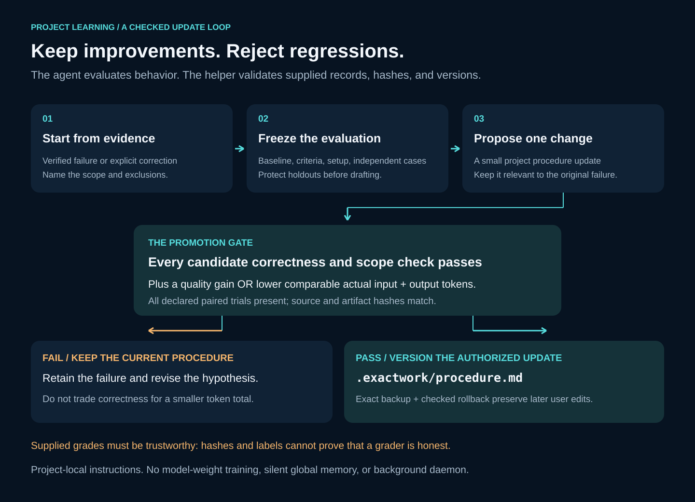
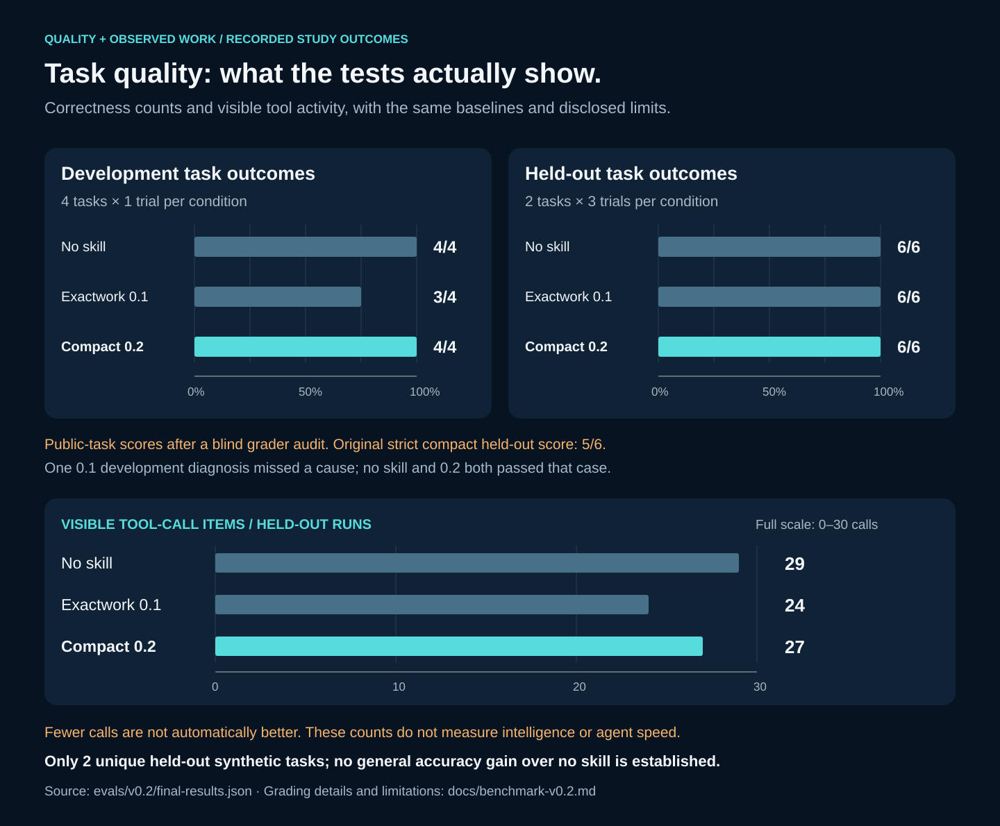
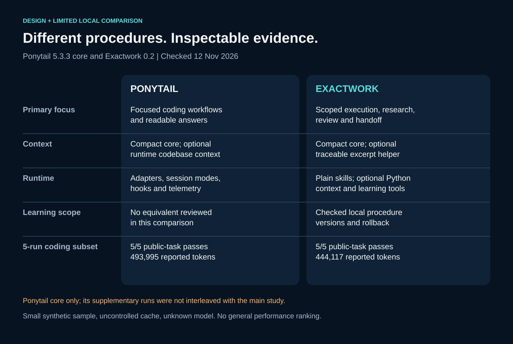

<div align="center">


# Exactwork — Agent Skills for Claude Code, Codex, OpenCode & DeepSeek Harness

**Focused work. Traceable context. Project learning with evidence and rollback.**

[MIT license](LICENSE) · Python 3.10+ for optional tools · Six independent skills · Reproducible evaluations

[Start here](#start-here) · [Skills](#choose-a-skill) · [Self-learning](#learn-a-project-procedure) · [Results](#what-the-tests-show) · [Compatibility](#use-it-with-your-agent) · [Research](docs/research.md)

</div>

Exactwork is a small collection of **Agent Skills for research, code review, task execution, handoffs, context extraction, and project-specific self-improvement**. The aim is to keep an agent focused on your requirements and make its work easier to check.

Pick the skill that fits your task. Each starts with a short `SKILL.md`; optional Python helpers handle log excerpts and local procedure updates. Your agent keeps its own tools and normal access. Exactwork requires no separate service or API key.

The repository includes measured results, unsuccessful outcomes, and the checks used to assess them. Token savings varied by task; a skill is not automatically an improvement. [Read the evidence](docs/benchmark-v0.2.md).

## Start here



Clone the repository, then preview installation into an **existing project**:

```sh
git clone https://github.com/theihtishaam/exactwork-skills.git
cd exactwork-skills

python tools/install.py --project "/path/to/project" --client codex
python tools/install.py --project "/path/to/project" --client codex --apply
```

The core is selected by default. The first installer command previews; `--apply` installs. Windows paths such as `"C:/Projects/my-app"` work; use `python3` if needed.

For another client or a companion skill:

```sh
# Install the core for Claude Code.
python tools/install.py --project "/path/to/project" --client claude --apply

# Install just the learning companion for OpenCode.
python tools/install.py --project "/path/to/project" --client opencode --skill exactwork-learn --apply

# Install all six skills for DeepSeek Harness.
python tools/install.py --project "/path/to/project" --client harness --all --apply
```

`--all` means six skills for **one client**. The installer preserves conflicting files and application settings. Manual copying is supported; Python **3.10+** is needed for the installer and optional helpers. [Installation behavior](docs/install-behavior.md).

## Use it with your agent


Start a fresh session in the target project and invoke a skill explicitly:

| Client | Project skill directory | Example invocation |
|---|---|---|
| **Codex** | `.agents/skills/` | `$exactwork Fix and test this export bug.` |
| **Claude Code** | `.claude/skills/` | `/exactwork Fix and test this export bug.` |
| **OpenCode** | `.opencode/skills/` | `@exactwork Fix and test this export bug.` |
| **DeepSeek Harness** | `.dsh/skills/` | `/exactwork Fix and test this export bug.` |

The installer also has `gemini`, `copilot`, `cursor`, `cline`, and `shared` targets. Paths were checked against documentation on **2026-11-12**. Your client version and settings determine discovery; a DeepSeek model follows the application running it.

The study used explicit instruction injection through Codex CLI; **native activation was not tested in every client**. Other text-capable agents can receive the chosen `SKILL.md` and its references manually. [Compatibility details and sources](docs/compatibility.md).

## Choose a skill



| Skill | Example task |
|---|---|
| [**exactwork**](skills/exactwork/SKILL.md) | Fix an export bug, preserve the interface, and verify the result. |
| [**exactwork-research**](skills/exactwork-research/SKILL.md) | Check the original evidence before recommending a change. |
| [**exactwork-review**](skills/exactwork-review/SKILL.md) | Review a queue implementation and report reproducible defects without editing it. |
| [**exactwork-handoff**](skills/exactwork-handoff/SKILL.md) | Prepare another session with current corrections, verified work, and blockers. |
| [**exactwork-context**](skills/exactwork-context/SKILL.md) | Extract relevant log lines with source references and explicit omissions. |
| [**exactwork-learn**](skills/exactwork-learn/SKILL.md) | Test a project procedure change, apply it if eligible, and retain rollback. |

A label correction usually needs only a direct edit. Load extra procedures when they help; keep domain-specific skills for their expertise.

## What happens during a task


The core keeps the requested deliverables, depth, and format in view. It asks the agent to read relevant evidence, expand incomplete context, finish affected contracts, and distinguish **prepared**, **executed**, and **verified** work.

These are instructions, not runtime guarantees. Correct work may take more tokens; a short response still has to satisfy the request. [Design and tradeoffs](docs/design.md).

## Read a large log


For context engineering on a large log, the optional selector returns bounded JSON with exact lines, source hashes, selected ranges, and omission counters:

```sh
python skills/exactwork-context/scripts/context_slice.py ./build.log --query "request-42" --context 3
```

Expand incomplete excerpts. Zero matches do not rule out defects, and successful extraction does not establish process success. Ordinary search is often enough. [Selector instructions](skills/exactwork-context/SKILL.md) · [Component measurements](docs/component-evidence.md).

## Learn a project procedure



Self-learning here means **improving a project procedure**. The agent proposes and tests a small rule; the helper checks the submitted records and file hashes.

1. Start from a verified failure or your explicit correction, with a clear scope.
2. Freeze the baseline, evaluation setup, rubric, and tasks before drafting the candidate. Keep independent holdouts separate.
3. Compare repair, transfer, regression, and held-out outcomes. Preserve failures and unknown measurements.
4. Promote only when all supplied candidate correctness and scope checks pass, plus a quality gain or comparable actual-token reduction is recorded.
5. Write only the selected project's **`.exactwork/procedure.md`**, retaining an exact backup and checked rollback.

> Use exactwork-learn to learn from this verified project failure. Propose one relevant procedure change, test it against independent cases, and apply it locally only if the evidence passes. Keep rollback available.

Future sessions must load the procedure for its stated scope. There is no background learner, automatic global memory, or model-weight update. The checker validates consistency; it cannot prove truthful grading, authentic telemetry, or genuinely hidden holdouts. **Longitudinal learning benefits have not been measured.** [Learning guide and commands](docs/learning.md).

## What the tests show


The study includes **35 scored agent runs**: 12 development, 18 held-out, and five supplementary Ponytail comparisons. The held-out subset used **two unique synthetic tasks, repeated three times per condition**:

| Condition | Public-task passes after audit | Aggregate reported input + output tokens |
|---|---:|---:|
| No skill | 6/6 | 817,122 |
| Exactwork 0.1 | 6/6 | 761,789 |
| Compact Exactwork 0.2 | 6/6 | 704,714 |

The compact version used **13.8% fewer aggregate tokens than no skill** and **7.5% fewer than 0.1**. It used more tokens on the log-task aggregate and saved tokens in only 3/6 paired trials. The original strict grader scored the compact condition 5/6; a blind audit accepted a valid alternative citation. Original scores, the correction, and a stricter sensitivity analysis remain available.



**Intelligence was not directly measured.** The quality chart shows task correctness, a limited measure of completed work. Equal held-out pass counts do not establish smarter reasoning or general accuracy gains. There is no measured long-term learning improvement yet.

The exact inherited model was not exposed, cache state was uncontrolled, and concurrent wall times do not establish agent speed or dollar savings. **111 software checks passed; four were skipped** for unavailable symbolic-link privileges. These checks are separate from model-performance results. [Full benchmark](docs/benchmark-v0.2.md) · [Verification](docs/verification.md) · [Result table](evals/v0.2/final-results.csv).

## How it compares with Ponytail



[Ponytail](https://github.com/DietrichGebert/ponytail), other skill collections, official documentation, and studies with mixed findings informed the design. Exactwork adds independently selectable evidence, handoff, context, and local learning procedures.

The comparison used pinned Ponytail **core instructions only**, excluding its runtime and review skill. Its runs came after the main study. Both passed the five-run coding subset; that does **not** establish general superiority. [Comparison](docs/comparison.md) · [Research](docs/research.md) · [Upgrade research](docs/upgrade-research.md).

## Run the checks

Run the package checks and offline evidence auditor without making model calls:

```sh
python -B -m unittest discover -s tests -v
python -B -m unittest discover -s skills/exactwork-context/tests -v
python -B evals/v0.2/learn-review/test_independent_review.py
python -B evals/v0.2/audit_results.py
python -B tools/validate.py
```

The [full verification commands](docs/verification.md) also cover the exporter and auditor mutation checks. Windows/Linux CI is configured; check the actual workflow results for its status.

Browse the [skills](skills), [tools](tools), [docs](docs), [evaluation records](evals/v0.2), and [editable graphics](assets). Original grades, corrections, observable traces, and audit tools are included.

Contributions should include a reproducible failure or measured improvement, with unsuccessful outcomes preserved. [Contributing guide](CONTRIBUTING.md). Code and skills use [MIT](LICENSE); [visual provenance](assets/PROVENANCE.md) identifies the AI-generated cover and authored diagrams.
