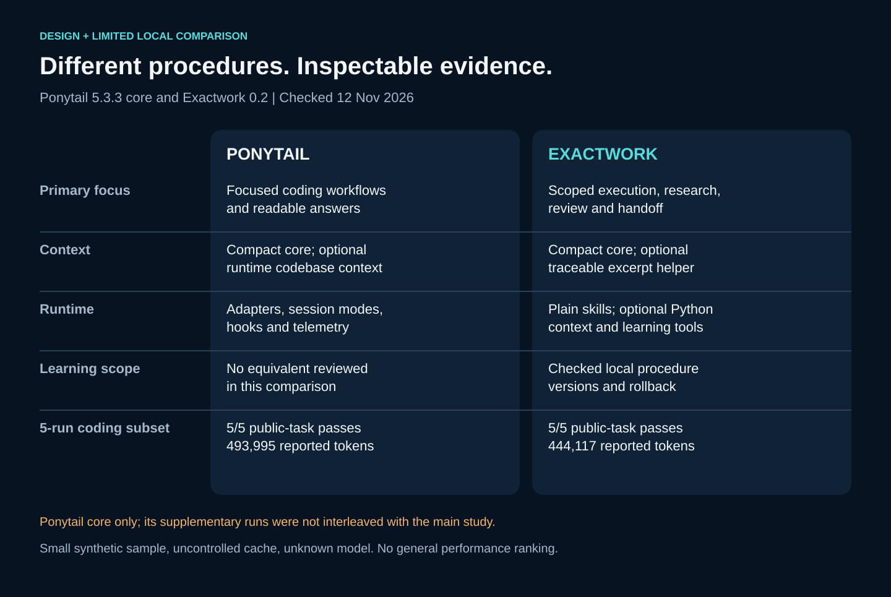

# Exactwork and Ponytail

Ponytail is a strong coding-focused project with substantive scope, safety, testing, and benchmark work. Exactwork is an original skill collection focused on portable task execution and evidence across different kinds of work. **This release does not establish that Exactwork outperforms Ponytail.**

Baseline inspected: [Ponytail 5.3.3, commit 96608e0](https://github.com/DietrichGebert/ponytail/tree/96608e078b2d5ea607c5c3b8b5a54d1c1fba6846), on 2026-11-12. These observations describe that snapshot.

| Area | Ponytail | Exactwork 0.2 |
|---|---|---|
| Main focus | Complete minimal code changes and readable answers | Scoped multi-step work, selective context, evidence, and completion |
| User intent | Traces affected code and protects requested scope | Explicitly preserves deliverables, depth, format, exclusions, and corrections |
| Context | Compact rules plus optional injected codebase map | Targeted reads, unchanged-evidence reuse, truncation awareness, bounded delegation |
| Specialist procedures | Coding review, audit, debt, gain, help | Optional research, review, handoff, context extraction, and project learning |
| Verification | Nontrivial logic checks; concrete review evidence | Checks chosen for code, data, factual, and visual outcomes |
| Runtime | Rich adapters, session modes, optional hooks and telemetry | Plain instructions with optional Python context/learning helpers; no hooks or background service |
| Integration tradeoff | More host-specific capabilities to maintain | Fewer host dependencies, but no automatic enforcement or session reinforcement |
| Behavioral evidence | Published author-run agentic benchmark | 35 scored local runs, actual usage, blind task-contract audit; no cross-client advantage established |

Sources: Ponytail's [core skill](https://github.com/DietrichGebert/ponytail/blob/96608e078b2d5ea607c5c3b8b5a54d1c1fba6846/skills/ponytail/SKILL.md), [review](https://github.com/DietrichGebert/ponytail/blob/96608e078b2d5ea607c5c3b8b5a54d1c1fba6846/skills/ponytail-review/SKILL.md), [activation](https://github.com/DietrichGebert/ponytail/blob/96608e078b2d5ea607c5c3b8b5a54d1c1fba6846/hooks/ponytail-activate.js), and [runtime](https://github.com/DietrichGebert/ponytail/blob/96608e078b2d5ea607c5c3b8b5a54d1c1fba6846/hooks/ponytail-runtime.js). Exactwork's implementation is in [skills](../skills).

## What the published numbers mean

Ponytail's [2026-10-07 agentic report](https://github.com/DietrichGebert/ponytail/blob/96608e078b2d5ea607c5c3b8b5a54d1c1fba6846/benchmarks/results/2026-10-07-agentic.md) reports 45% fewer output tokens and 26% lower cost versus no skill in its stated setup. These are its author's results, not measurements performed for Exactwork. The report uses 39 tasks, five repetitions, and one primary model/host configuration. Its limitations matter: Bash was disabled during agent sessions, and hidden runnable correctness checks covered 18 tasks. The report describes correctness as essentially level between arms.

Those values are not a benchmark target already beaten here. Output tokens are not total input/context tokens. Comparing our Markdown byte counts with theirs cannot reproduce their cost or quality claims.

## What is concretely different

Exactwork removes the need for a runtime integration to use its full instruction set; it does not duplicate Ponytail's telemetry product. It adds standalone procedures for conflicting evidence and faithful task handoffs, plus traceable extraction and checked local procedure versioning. The learning helper validates supplied evidence consistency; it does not train a model or prove the evidence is truthful. The distribution tools refuse silent replacement of an existing skill. The reporting protocol treats unavailable usage as `null`, never as zero or character counts mislabeled as tokens.

These are inspectable design properties. Whether they improve your work requires [matched evaluations](../evals/README.md). Use Ponytail when its coding workflow and integrations suit you; use Exactwork when this lighter, broader procedure suits you. Avoid loading overlapping instruction layers automatically.

## Our limited 0.2 comparison

On the matched five-run coding subset, all four conditions passed 5/5 public-task outcomes. Aggregate reported input+output tokens were 612,815 for no skill, 541,987 for Exactwork 0.1, 444,117 for compact 0.2, and 493,995 for Ponytail core. That is 10.1% lower for compact 0.2 than Ponytail in this subset, with no demonstrated accuracy advantage.

These are only three unique synthetic tasks, including repeated queue reviews. Ponytail's five supplementary runs came later and were not interleaved with the main study. Its full runtime and review-specific skill were not evaluated. Exact inherited model identity and cache state were uncontrolled. Read the [full method, individual results, and limitations](benchmark-v0.2.md) before making a comparison claim.
